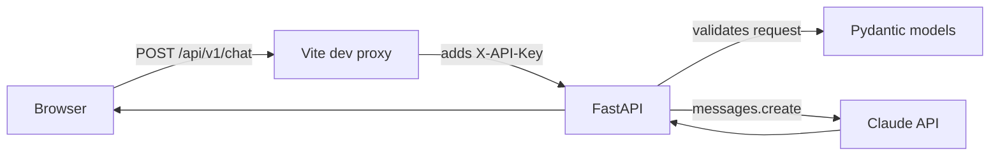

# Architecture

## Decisions

| Decision | Chosen | Rejected | Why |
|---|---|---|---|
| API framework | FastAPI | Flask, Django REST | Native Pydantic validation and generated OpenAPI docs with little code |
| Key handling | Dev proxy injects the app key | Key in a `VITE_` variable | `VITE_` variables ship in the browser bundle |
| Config | pydantic-settings | Raw `os.environ` | Typed settings that fail fast when a value is missing |
| Styling | Tailwind with CSS brand tokens | Component library | Small footprint for a smoke test; tokens are reusable across apps |

## What changes at 100x load

The synchronous `chat` handler blocks a worker per LLM call. First change: async client, request timeouts, and rate limiting per API key. Then move long calls to a background job queue.
