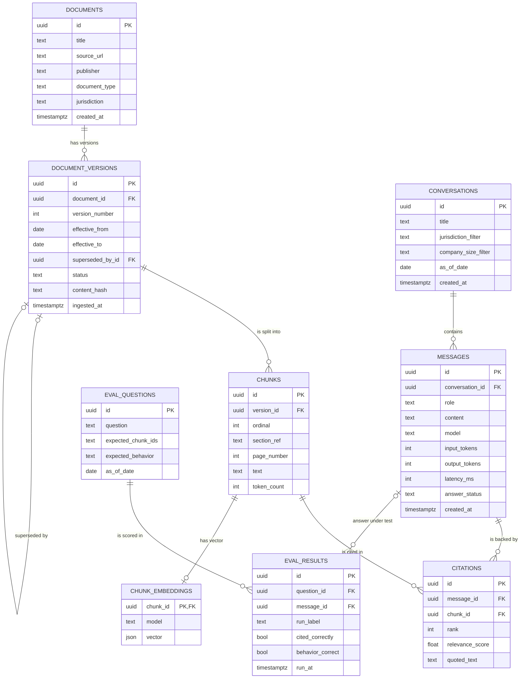

# Database design

Relational schema for the regulatory change navigator. PostgreSQL in the target and SQLite in the pilot, both managed with the same Alembic migrations. The relational database is the system of record. In the pilot the vectors are stored in the database too (`chunk_embeddings`) and searched in memory. In the Azure target they move to Azure AI Search.

## Entity relationship diagram

## Tables

| Table | Purpose | Notes |
|---|---|---|
| `documents` | One row per source text, such as a directive or a standard | Holds what never changes between versions: title, publisher, source URL, jurisdiction |
| `document_versions` | One row per version of a document | `effective_from` and `effective_to` give the dates the version is in force; `superseded_by_id` links to the replacement; `status` is `current`, `superseded` or `draft` |
| `chunks` | Passages of a version, as split for search | `section_ref` and `page_number` let a citation point to the exact place |
| `chunk_embeddings` | One vector per chunk (768 numbers) and the model that made it | Kept apart from `chunks` so the embedding model can be swapped without touching the text. Loaded into memory for search in the pilot |
| `conversations` | One chat session | Stores the filters (jurisdiction, company size) and the `as_of_date` the user asked about |
| `messages` | Each user question and assistant answer | Records model, token counts and latency, which the cost estimate and the 8-second target both need; `answer_status` is `answered`, `insufficient_evidence` or `conflict` |
| `citations` | Which chunks supported an assistant message | `rank` orders them; `quoted_text` keeps the exact words shown to the user |
| `eval_questions` | The 40 test questions with the expected result | `expected_behavior` is `answer` or `refuse` |
| `eval_results` | Scores for each run | Lets us show accuracy improving between runs |

## Indexes

| Index | Why |
|---|---|
| `document_versions (document_id, effective_from)` | Find the version in force on a date |
| `document_versions (status)` | List current versions quickly |
| `chunks (version_id, ordinal)` | Rebuild a document in order |
| `messages (conversation_id, created_at)` | Load a conversation in order |
| `citations (message_id, rank)` | Show citations in order |
| `citations (chunk_id)` | Find every answer that used a chunk, for example after a source is corrected |
| `documents (jurisdiction)` | Filter by country |

## Design decisions and rejected alternatives

| Decision | Chosen | Rejected | Why |
|---|---|---|---|
| Handling changing rules | Separate `document_versions` table with effective dates | Overwrite the document in place; keep only the latest version | The assistant must answer for a past or future date, which needs the old versions. Overwriting would make that impossible. The cost is more rows and a join. |
| Where embeddings live | Pilot: a `chunk_embeddings` table, searched in memory. Target: Azure AI Search, keyed by `chunks.id` | `pgvector` in PostgreSQL; a separate vector database | Azure AI Search is the required stack for UC1 and gives hybrid search and filtering. `pgvector` would avoid a second datastore, but is outside the brief and needs a PostgreSQL server the pilot lacks. A table is enough for 2,047 chunks. The cost is keeping two stores in sync once Azure AI Search is added. |
| System of record | A relational database (PostgreSQL, SQLite in the pilot) | MongoDB or Azure Cosmos DB for MongoDB | The data is relational: documents have versions, versions have chunks, chunks have citations. The key query is a date-range lookup of the version in force, and the key integrity rule is that every citation points to a real chunk. Foreign keys, constraints and indexes give both. A document store would suit schema-free content but would leave these rules to application code. The brief also names PostgreSQL. The cost is a fixed schema and a migration for each change. |
| Citation storage | A `citations` table linking messages to chunks | A JSON column on `messages` | A table lets us ask which answers used a chunk, and enforces that every citation points to a real chunk. JSON is simpler to write but cannot be queried or checked as easily. |
| Filters on a conversation | Columns on `conversations` | A single JSON column | The filters are known and few, so columns give type checking and clear migrations. JSON would be easier to extend but easier to get wrong. |
| Primary keys | UUIDs | Auto-incrementing integers | UUIDs can be created in the application and do not reveal counts in URLs. The cost is slightly larger indexes. |

## What changes at 100x load

- **Messages and citations grow fastest.** At 5,000 users, token counts and latency on `messages` make it the largest table. First change: partition `messages` by month and archive old conversations.
- **Chunk reads dominate.** Answers read chunk text on every request. First change: cache hot chunks and keep chunk text in Azure AI Search so most requests skip PostgreSQL.
- **Version lookups.** The date query is cheap with the index above, but a cache of the current version per document would remove most of those queries.

## Open points

- Confirm with the UC1 brief whether user accounts are needed. The program requires only API-key authentication, so this design has no users table. Add one if conversations must belong to a person.
- In the Azure target, embeddings and keyword fields are defined in the Azure AI Search index, described in the solution design document. The pilot keeps them in `chunk_embeddings`.
