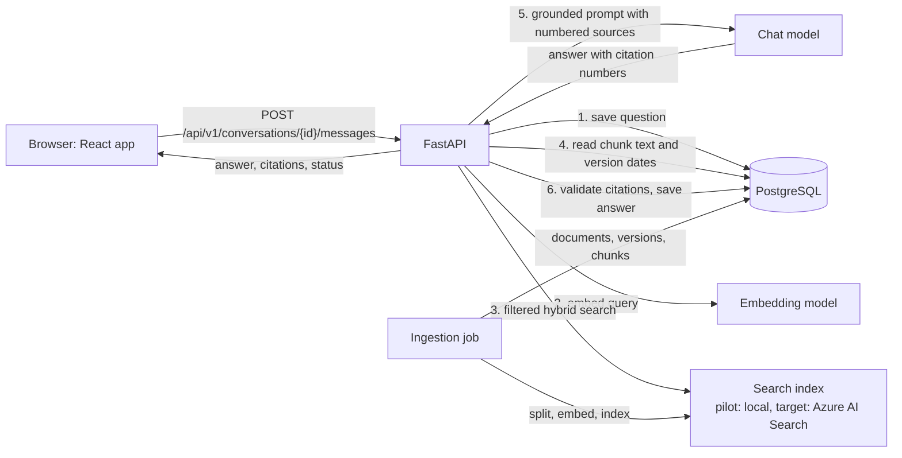

# Solution design: Regulatory change navigator

Use Case 1, RAG knowledge chatbot. Status: draft for review. Items marked "verify" must be checked against official documentation before this document is final. The pilot runs on a local stack; the Azure services are the design target (see section 1.1).

## 1. Overview

The system answers EU sustainability reporting questions from a controlled library of public sources. Every answer carries citations, respects the date the user asks about, and says so when the evidence is too weak. The problem, users and success criteria are in the [problem statement](problem-statement.md). The data model is in the [database design](database-design.md).

### 1.1 Deviation from the required stack

The program names Azure AI Search and Azure OpenAI or the Claude API for this use case. No access to the shared Azure Resource Group or the issued model keys was available while building. This is the deviation and how it is handled:

| Item | Required stack | Pilot implementation | Why it is safe to swap |
|---|---|---|---|
| Search index | Azure AI Search | Local hybrid search over the database | Search sits behind one interface (`SearchIndex`), so only one class changes |
| Embeddings | Azure OpenAI embedding model | `gemini-embedding-001` | Embedding calls sit behind one function |
| Chat model | Azure OpenAI or Claude API | Gemini (`gemini-3.1-flash-lite`) | The model name and client are configuration |
| Database | PostgreSQL | SQLite, same SQLAlchemy models and Alembic migrations | Only `DATABASE_URL` changes |

What this means for the claims in this document:
1. The architecture, data model, API design and evaluation are real and tested locally.
2. Azure AI Search is the target. Sections 6.1 and 6.2 explain why, but nothing here claims it was deployed.
3. Cost figures for Azure services are estimates from published prices and are not measurements.

## 2. Architecture

Every arrow is one call. Steps 1 to 6 run in order for each question. The ingestion job runs separately, whenever the library changes.

## 3. Components

| Component | Responsibility |
|---|---|
| React app | Chat screen, filters (country, company size, date), citation panel, conversation list. Shares the DataFactZ layout shell from Day 1. |
| FastAPI routers | HTTP only: validate input, check the API key, return typed responses. No business logic. |
| Services | `RetrievalService` (search and date filtering), `AnswerService` (prompt, model call, citation checks), `IngestionService` (split, embed, index). |
| Data access | PostgreSQL through SQLAlchemy; Azure AI Search through its client. |
| PostgreSQL | System of record: documents, versions, chunks, conversations, messages, citations. |
| Search index | Finds relevant chunks by keyword and meaning, with metadata filters. Pilot: local implementation. Target: Azure AI Search. |
| Chat model | Writes the answer using only the sources it is given. |

## 4. Data flow for one question

1. The API saves the question and the filters (country, company size, as-of date).
2. The question is turned into an embedding.
3. Azure AI Search runs a hybrid search (keywords plus meaning) with filters on country, company size, and `effective_from <= as_of_date < effective_to`. It returns the top candidates.
4. The service loads those chunks and their version details from PostgreSQL. If a returned chunk belongs to a superseded version, it is marked.
5. If the best relevance score is below a threshold, or nothing passes the filters, the API answers `insufficient_evidence` without calling the model.
6. Otherwise the model receives the question and numbered sources, with instructions to use only those sources and to cite by number.
7. The API checks that every citation number refers to a source it supplied, drops answers that cite nothing, and saves the answer, citations, token counts and latency.

## 5. API surface

All routes are under `/api/v1`, protected by an `X-API-Key` header, with Pydantic request and response models. Errors use proper status codes, never 200 with an error body.

| Method and route | Purpose | Success | Errors |
|---|---|---|---|
| `GET /health` | Liveness check | 200 | |
| `POST /conversations` | Start a conversation with filters and as-of date | 201 | 401, 422 |
| `GET /conversations` | List conversations | 200 | 401 |
| `GET /conversations/{id}` | One conversation with messages and citations | 200 | 401, 404 |
| `POST /conversations/{id}/messages` | Ask a question, get a cited answer | 201 | 401, 404, 422, 502 |
| `GET /citations/{id}` | The exact source passage and its version details | 200 | 401, 404 |
| `POST /documents` | Add a source document version (admin) | 202 | 401, 422 |
| `GET /documents` | List sources and their versions | 200 | 401 |

`POST /documents` returns 202 because ingestion runs as a background job.

## 6. Pattern justification

Each decision names the options considered. Claims about product features are marked "verify" until checked.

### 6.1 Retrieval method

| Option | Pros | Cons |
|---|---|---|
| **Hybrid search (keywords plus vectors) with filters** (chosen) | Exact terms such as article numbers match by keyword; paraphrased questions match by meaning; filters handle country and dates | More configuration than either alone |
| Vector search only | Simple | Misses exact references like "Article 29b"; weak on identifiers |
| Keyword search only | Precise for exact terms | Misses paraphrased questions |

Chosen because regulatory questions mix exact references and plain-language wording. The pilot implements this locally by combining keyword scores with embedding similarity. Verify that hybrid search and filters are available on the Azure AI Search tier in the shared Resource Group before the move.

### 6.2 Vector store

| Option | Pros | Cons |
|---|---|---|
| **Azure AI Search** (target) | Required stack for UC1; hybrid search and metadata filters in one service; managed | Second datastore to keep in sync; cost grows with tier; not available during the pilot build |
| **Local search behind an interface** (pilot) | Works without Azure access; same filters and scoring ideas; easy to test | Does not scale; no managed ranking features |
| `pgvector` in PostgreSQL | One datastore; relational joins with metadata; lowest cost | Outside the required stack; weaker hybrid search tooling; slower at large scale |
| FAISS | Fast, free, runs locally | No filtering or persistence by default; nothing managed; not suitable for production |

### 6.3 Chunking strategy

| Option | Pros | Cons |
|---|---|---|
| **Structure-aware chunks** (by article or section, with a size limit and small overlap) (chosen) | Citations point to a real article; chunks keep their meaning | Needs parsing per document type |
| Fixed-size chunks | Simple to build | Cuts sentences and articles in half; poor citations |
| Whole-document embeddings | Fewest chunks | Too coarse to cite; wastes model context |

Chunk size and overlap will be tuned on the evaluation set, not guessed.

### 6.4 Chat model

| Option | Pros | Cons |
|---|---|---|
| **Azure OpenAI chat model** (target, if available in the Resource Group) | Same cloud as search; no data leaves Azure; one bill | Depends on the models granted to the group; not available during the pilot build |
| **Gemini** (pilot) | Free tier; works now; has an embedding model | Different provider from the target; free-tier limits and occasional overload |
| Claude API | Strong at following citation instructions; useful for the program's required model comparison | Separate provider; Claude has no embedding model, so an Azure embedding model is still needed |
| Small open-source model | Lowest cost | Weaker answer quality; hosting effort |

The program expects a comparison of at least two models. The plan is to build with one and run the evaluation set against a second, reporting accuracy, cost and speed. Verify which models are available in the shared Resource Group once access is granted.

### 6.5 Handling changing rules

| Option | Pros | Cons |
|---|---|---|
| **Version table with effective dates, filtered at search time** (chosen) | Answers any date correctly; old versions stay available | More data and a more complex search filter |
| Keep only the latest version | Simplest | Cannot answer past or future dates |
| Re-index on every change and delete the old index | Always current | Loses history; cannot explain what changed |

### 6.6 Framework

| Option | Pros | Cons |
|---|---|---|
| **Plain Python services with direct SDK calls** (chosen) | Every step is visible and testable; easy to explain in review | More code to write |
| LangChain | Many ready-made parts | Hides the retrieval steps; harder to debug and defend |
| LlamaIndex | Strong for document indexing | Same trade-off; adds a layer between the code and the services |

### 6.7 Backend runtime

| Option | Pros | Cons |
|---|---|---|
| **FastAPI with async endpoints** (chosen) | Pydantic validation, generated OpenAPI docs, async calls to the model and search | Async needs care with the database driver |
| Flask | Familiar | No built-in validation or async focus |
| Django REST | Full framework with an admin panel | Heavier than this service needs |

## 7. Security considerations

- **Authentication:** API-key header on every route. Keys live in environment variables, never in git.
- **Secrets:** `.env` is git-ignored. The frontend never holds the key; the development proxy adds it.
- **Prompt injection:** retrieved text is treated as data. The prompt tells the model to ignore instructions found in sources, and the service rejects answers whose citations do not match the supplied sources.
- **Data scope:** the library holds public sources only. Client documents would need per-client indexes or filters, access checks on every query and an audit trail. This is out of scope for the pilot and is listed as a later phase.
- **Logging:** log question length, latency, token counts and answer status. Do not log full question text by default, since users may paste client details.
- **Input limits:** a maximum question length and rate limits per API key.

## 8. Quality and evaluation

- 40 test questions in `eval_questions`, split into questions the library can answer, questions it cannot, and date-sensitive questions.
- Each run records whether the correct passage was cited and whether the assistant answered or refused as expected.
- Unit tests cover the core logic: chunking, date filtering, citation validation and the refusal threshold. Tests do not call real models.

## 9. What changes at 100x load

| What breaks first | Change |
|---|---|
| Each question makes sequential network calls (embedding, search, database, model), and the model call dominates latency | Keep async calls; cache embeddings of repeated questions; stream the answer to the browser |
| Model rate limits and cost at 5,000 users | Request queueing and per-key rate limits; a smaller model for simple questions, with the larger one only when retrieval is uncertain |
| Azure AI Search throughput | Add replicas; use a higher service tier |
| `messages` table growth | Partition by month; archive old conversations |
| Ingestion of large documents | Move to a worker queue with retries; the API already returns 202 |
| One API instance | The API is stateless, so run several behind a load balancer |

## 10. Cost

See the [cost estimate](cost-estimate.md): about $128 a month for 100 users and about $1,669 for 5,000 users on the Azure target, with token prices verified on 2026-11-19 and infrastructure figures marked as unverified.

## 11. Built so far and known limits

| Area | State |
|---|---|
| Data | 10 public documents loaded: 7 documents, 10 versions, 2,047 chunks |
| Embeddings | 950 of 2,047 chunks have vectors. The Gemini free tier allows 1,000 embedding requests a day and that limit was reached. The decision is to keep this set |
| Search | Hybrid ranking for chunks with vectors; keyword-only ranking for the rest and whenever the query cannot be embedded |
| Chat API | Conversations, cited answers, refusal on weak evidence, citation validation, 401/404/422/502 codes |
| Chat screen | React app with date and jurisdiction filters and an expandable citation panel |
| Evaluation | 20 questions, 18 to 19 correct on repeated runs (see [evaluation results](evaluation-results.md) and [model comparison](model-comparison.md)) |
| Source conflicts | Answers that cite both legal text and news or guidance pages are flagged, with a note that the legal text prevails |
| Not built | `POST /documents` upload |
| Dropped on purpose | Company-size filter. Size thresholds are written inside the legal text, not stored as metadata on a document, so a filter would be invented data. Questions about size are answered from the text itself |

## 12. Open items

- Confirm the scenario, success targets and any required models against the UC1 brief.
- Request access to the shared Azure Resource Group and the issued model keys, then verify which services and models they provide.
- Verify Azure AI Search feature and tier details cited in section 6, and the infrastructure prices in the cost estimate.
- Rerun the evaluation once the embedding quota resets, to measure full hybrid search.
- A news page (3 July 2026) says the revised ESRS were awaiting scrutiny while the Official Journal text says they took effect on 10 November 2026. The chatbot flags answers that mix such sources but does not decide which statement is right.
