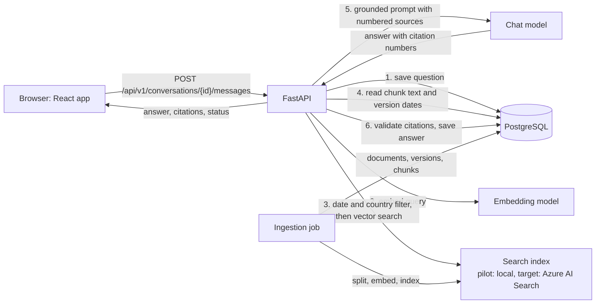

# Solution design: Regulatory change navigator

Use Case 1, RAG knowledge chatbot. Status: draft for review. Items marked "verify" must be checked against official documentation before this document is final. The pilot runs on a local stack; the Azure services are the design target (see section 1.1).

## 1. Overview

The system answers EU sustainability reporting questions from a controlled library of public sources. Every answer carries citations, respects the date the user asks about, and says so when the evidence is too weak. The problem, users and success criteria are in the [problem statement](problem-statement.md). The data model is in the [database design](database-design.md).

### 1.1 Deviation from the required stack

The program names Azure AI Search and Azure OpenAI or the Claude API for this use case. No access to the shared Azure Resource Group or the issued model keys was available while building. This is the deviation and how it is handled:

| Item | Required stack | Pilot implementation | Why it is safe to swap |
|---|---|---|---|
| Search index | Azure AI Search | Local vector search (numpy, in memory) with keyword fallback, or local hybrid search. Chosen by `SEARCH_BACKEND` | Search sits behind one interface (`SearchIndex`), so only one class changes |
| Embeddings | Azure OpenAI embedding model | `gemini-embedding-001` | Embedding calls sit behind one function |
| Chat model | Azure OpenAI or Claude API | Gemini (`gemini-3.1-flash-lite`) | The model name and client are configuration |
| Database | PostgreSQL | SQLite, same SQLAlchemy models and Alembic migrations | Only `DATABASE_URL` changes |

What this means for the claims in this document:
1. The architecture, data model, API design and evaluation are real and tested locally.
2. Azure AI Search is the target. Sections 6.1 and 6.2 explain why, but nothing here claims it was deployed.
3. Cost figures for Azure services are estimates from published prices and are not measurements.

## 2. Architecture

Every arrow is one call. Steps 1 to 6 run in order for each question. The ingestion job runs separately, whenever the library changes.

## 3. Components

| Component | Responsibility |
|---|---|
| React app | Chat screen, filters (country, date), citation panel, conversation list. Shares the DataFactZ layout shell from Day 1. |
| FastAPI routers | HTTP only: validate input, check the API key, return typed responses. No business logic. |
| Services | Search (`search.py`: date filtering and ranking), answers (`answer.py`: prompt, model call, citation checks), ingestion (`ingestion.py`: split, version, store), embeddings (`embeddings.py`). |
| Data access | PostgreSQL through SQLAlchemy; Azure AI Search through its client. |
| PostgreSQL | System of record: documents, versions, chunks, conversations, messages, citations. |
| Search index | Finds relevant chunks by meaning after filtering by date and country; falls back to keywords when a question cannot be embedded. Pilot: in-memory vector index. Target: Azure AI Search. |
| Chat model | Writes the answer using only the sources it is given. |

## 4. Data flow for one question

1. The API saves the question and the filters (country and as-of date).
2. The question is turned into an embedding.
3. The search index keeps only chunks whose version was in force on the as-of date and that match the country filter, then ranks them by similarity to the question. It returns the top candidates. If the question cannot be embedded, keyword ranking is used instead.
4. The service loads those chunks and their version details from PostgreSQL. If a returned chunk belongs to a superseded version, it is marked.
5. If the best relevance score is below a threshold, or nothing passes the filters, the API answers `insufficient_evidence` without calling the model.
6. Otherwise the model receives the question and numbered sources, with instructions to use only those sources and to cite by number.
7. The API checks that every citation number refers to a source it supplied, drops answers that cite nothing, and saves the answer, citations, token counts and latency.

## 5. API surface

All routes are under `/api/v1`, protected by an `X-API-Key` header, with Pydantic request and response models. Errors use proper status codes, never 200 with an error body.

| Method and route | Purpose | Success | Errors |
|---|---|---|---|
| `GET /health` | Liveness check | 200 | |
| `POST /conversations` | Start a conversation with filters and as-of date | 201 | 401, 422 |
| `GET /conversations` | List conversations | 200 | 401 |
| `GET /conversations/{id}` | One conversation with messages and citations | 200 | 401, 404 |
| `POST /conversations/{id}/messages` | Ask a question, get a cited answer | 201 | 401, 404, 422, 502 |
| `GET /citations/{id}` | The exact source passage and its version details | 200 | 401, 404 |
| `POST /documents` | Add a source document version (admin) | 202 | 401, 422 |
| `GET /documents` | List sources and their versions | 200 | 401 |

`POST /documents` returns 202 because ingestion runs as a background job.

## 6. Architecture decisions

Each decision is recorded the same way: what we chose, why it beats the alternatives, and what about this project drives the choice. Rejected alternatives and their trade-offs follow in the option tables. Claims about product features are marked "verify" until checked against official documentation.

### 6.0 Decision summary

| # | Decision | Why this over the rest | What this project changes |
|---|---|---|---|
| 6.1 | Vector search, filtered by date and country first | Users ask in plain language while the law uses its own terms, so matching on meaning beats matching on words | The as-of date is a hard filter applied before ranking, so a superseded paragraph can never outrank the text in force |
| 6.2 | In-memory vector index behind a `SearchIndex` interface | It is the only vector option that runs under this machine's security policy, and at 2,047 chunks exact search is both fast and error-free | The corpus is small and fixed, so approximate indexes add complexity with no gain; the interface keeps Azure AI Search a one-class swap |
| 6.3 | Structure-aware chunks | Splitting at articles keeps each chunk a complete legal thought | Lawyers cite by article, so the chunk boundary is the citation boundary |
| 6.4 | Gemini 3.1 Flash-Lite for answers, gemini-embedding-001 for vectors | Free, one provider for both calls, and within one question of a second model on our evaluation | The model only rewrites supplied passages with citations, a task where a small model is enough |
| 6.5 | Versioned documents with effective dates | It is the only design that can answer a question about a past date | The CSRD changed three times in 14 months, so date-correct answers are the product, not a feature |
| 6.6 | Plain Python services, no orchestration framework | Every retrieval step stays visible and testable | The refusal and citation checks must be explainable line by line in review |
| 6.7 | FastAPI | Typed validation and generated API docs with no extra code | Day 1 already uses it, so both projects share one pattern |
| 6.8 | Refusal and citation checks in code, not only in the prompt | A prompt can be ignored by the model; code cannot | In advisory work a confident wrong answer costs more than an honest refusal |

### 6.1 Retrieval method

**Decision.** Vector search is the default. The service first keeps only chunks from the version in force on the chosen date and country, then ranks them by cosine similarity to the question. If the question cannot be embedded (quota or outage), search falls back to keyword ranking. Hybrid ranking (keywords plus vectors) stays available through `SEARCH_BACKEND=hybrid`.

**Why this over the rest.** Advisers ask "who has to report?" while the Directive says "undertakings". Meaning matches that gap; keywords do not.

**What the project changes.** Filtering before ranking is the key design point. Date is part of correctness here, not relevance, so it is enforced as a rule rather than left to a score.

| Option | Pros | Cons |
|---|---|---|
| **Vector search with metadata filters first** (chosen) | Handles paraphrase; filters guarantee the right version and country | Weaker on exact identifiers such as "Article 29b" |
| Hybrid (keywords plus vectors, merged by rank) | Covers both exact references and paraphrase | Two scores to tune and explain; kept as a setting and measured in evaluation |
| Keyword search only | Precise for exact terms | Misses plain-language questions |

**Trade-off accepted.** Exact references can rank lower under vector-only search. The keyword fallback and the hybrid setting cover this, and the 40-question evaluation is the evidence for keeping or changing the default. Verify hybrid search and filters on the Azure AI Search tier in the shared Resource Group before the move.

### 6.2 Vector store

**Decision.** An in-memory vector index (`VectorIndex`) holds all vectors as one normalised matrix and is rebuilt when the stored count changes. It sits behind the `SearchIndex` interface. Azure AI Search is the production target.

**Why this over the rest.** ChromaDB, Qdrant (local mode) and FAISS were all tried on the pilot machine and none would load, because Windows Application Control blocks their native components (`grpc`, `_swigfaiss`). The block was not bypassed. A numpy matrix has no extra native component of its own to block.

**What the project changes.** The library is 2,047 chunks and rarely changes, so brute-force comparison is exact and takes about 16 ms. Approximate nearest-neighbour indexes exist to trade accuracy for speed at millions of items. We need neither the trade nor the complexity.

| Option | Pros | Cons |
|---|---|---|
| **In-memory vector index** (pilot) | No native components; exact results; easy to test; filters by date and country first | Does not scale past tens of thousands of chunks; rebuilt in memory |
| **Azure AI Search** (target) | Required stack; hybrid search and filters in one managed service | Second datastore to keep in sync; cost grows with tier; no access during the pilot |
| `pgvector` in PostgreSQL | One datastore; joins with metadata; lowest cost | Outside the required stack; needs a PostgreSQL server the pilot does not run |
| ChromaDB, Qdrant local, FAISS | Purpose-built vector stores | Failed to load on the pilot machine; would need an IT allow-list or a container |

**Trade-off accepted.** No scaling headroom. At 100 times the load the index moves to Azure AI Search, which the interface makes a one-class change.

### 6.3 Chunking strategy

**Decision.** Split at the document's own headings (Article, Section, Chapter, Annex), cap each chunk at about 350 tokens, and carry a 40-token overlap when a long section is cut.

**Why this over the rest.** Fixed-size chunks slice articles mid-sentence and produce citations nobody can check. Whole-document embeddings are too coarse to cite and waste model context.

**What the project changes.** In legal work the citation is the deliverable. Tying the chunk boundary to the article boundary means every citation points to something a lawyer would recognise.

| Option | Pros | Cons |
|---|---|---|
| **Structure-aware chunks** (chosen) | Citations point to a real article; chunks keep their meaning | Needs heading rules per document type |
| Fixed-size chunks | Simple | Cuts articles in half; poor citations |
| Whole-document embeddings | Fewest chunks | Too coarse to cite |

**Trade-off accepted.** Heading detection is rule-based and fits EU legal text better than web pages. Chunk size and overlap are tuned on the evaluation set, not guessed.

### 6.4 Chat model

**Decision.** `gemini-3.1-flash-lite` writes answers and `gemini-embedding-001` creates vectors. `gemini-3.5-flash-lite` was run on the same questions as the required second model.

**Why this over the rest.** It is free to start, one key covers both calls, and on our comparison it was within one question of the second model at lower cost per question. A Claude model was not an option without a key, and Claude has no embedding model.

**What the project changes.** The model does not recall law. It rewrites passages it is handed and cites them, which is a constrained task. That is why a small, cheap model is a reasonable choice here and would not be for open-ended advice.

| Option | Pros | Cons |
|---|---|---|
| **Gemini** (pilot) | Free tier; works now; includes an embedding model | Different provider from the target; free-tier limits; free-tier content may be used to improve Google products |
| **Azure OpenAI** (target) | Same cloud as search; data stays in Azure; one bill | Depends on the models granted to the group; not available during the pilot |
| Claude API | Strong at following citation instructions | Separate provider; still needs an embedding model from elsewhere |
| Small open-source model | Lowest cost | Weaker answers; hosting effort |

**Trade-off accepted.** The free tier is for public documents only. Client material needs a paid tier or Azure. Verify which models the shared Resource Group provides once access is granted.

### 6.5 Handling changing rules

**Decision.** Each document has versions with an effective start and end date. A new version closes the previous one on its start date. Search filters on `effective_from <= as_of < effective_to`.

**Why this over the rest.** Keeping only the latest text cannot answer a question about last year's report. Rebuilding the index on every change loses history and cannot explain what changed.

**What the project changes.** The Directive moved through three versions in 14 months. A user preparing a 2024 report needs 2024 rules. Date-correctness is the core requirement, so the data model is built around it.

| Option | Pros | Cons |
|---|---|---|
| **Version table with effective dates** (chosen) | Answers any date; old versions stay available | More data and a more complex filter |
| Keep only the latest version | Simplest | Cannot answer past or future dates |
| Re-index on every change, delete the old | Always current | Loses history; cannot explain what changed |

**Trade-off accepted.** A new version must start after the previous one, and ingestion rejects back-dated versions rather than guessing.

### 6.6 Framework

**Decision.** Plain Python services calling the model and embedding APIs directly.

**Why this over the rest.** Orchestration frameworks hide the retrieval and prompt steps behind abstractions. Here every step is a small function we can test and show.

**What the project changes.** The value of this system is its guard rails: the evidence threshold, the citation check, the refusal. These must be explainable line by line to a reviewer, which a framework makes harder.

| Option | Pros | Cons |
|---|---|---|
| **Plain Python services** (chosen) | Visible, testable, easy to defend | More code to write |
| LangChain | Many ready-made parts | Hides retrieval; harder to debug |
| LlamaIndex | Strong document indexing | Same trade-off; extra layer |

### 6.7 Backend runtime

**Decision.** FastAPI with Pydantic models. Endpoints are synchronous today; they move to async if concurrent load requires it.

**Why this over the rest.** Request validation, typed responses and generated API documentation come built in.

**What the project changes.** The Day 1 service already uses FastAPI, so both projects share one pattern and one set of conventions for keys, errors and tests.

| Option | Pros | Cons |
|---|---|---|
| **FastAPI** (chosen) | Validation, OpenAPI docs, async ready | Async needs care with the database driver |
| Flask | Familiar | No built-in validation |
| Django REST | Full framework with admin | Heavier than this service needs |

### 6.8 Grounding and refusal

**Decision.** Two checks run in code, outside the model. Before the model is called, the best match must clear an evidence threshold or the answer is `insufficient_evidence`. After the model answers, every citation number must refer to a source it was given, and an answer with no valid citation is replaced by a refusal. Answers that cite both legal text and news or guidance pages are flagged, with a note that the legal text prevails.

**Why this over the rest.** A prompt that says "only use the sources" can be ignored by the model. A check in code cannot be.

**What the project changes.** The users are advisers whose output goes to clients. A confident wrong answer is worse than "I could not find support for this", so the system is built to prefer refusal.

| Option | Pros | Cons |
|---|---|---|
| **Code checks plus prompt rules** (chosen) | Enforced regardless of model behaviour | Can refuse a question the model could have answered |
| Prompt rules only | Simplest | Not enforceable |
| Second model as a judge | Can catch subtle errors | Extra cost and latency; its own failure modes |

**Trade-off accepted.** Some valid questions are refused. The evaluation measures this, and the threshold is tuned on it.

## 7. Security considerations

- **Authentication:** API-key header on every route. Keys live in environment variables, never in git.
- **Secrets:** `.env` is git-ignored. The frontend never holds the key; the development proxy adds it.
- **Prompt injection:** retrieved text is treated as data. The prompt tells the model to ignore instructions found in sources, and the service rejects answers whose citations do not match the supplied sources.
- **Data scope:** the library holds public sources only. Client documents would need per-client indexes or filters, access checks on every query and an audit trail. This is out of scope for the pilot and is listed as a later phase.
- **Logging:** log question length, latency, token counts and answer status. Do not log full question text by default, since users may paste client details.
- **Input limits:** a maximum question length and rate limits per API key.

## 8. Quality and evaluation

- 40 test questions in `eval_questions`, split into questions the library can answer, questions it cannot, and date-sensitive questions.
- Each run records whether the correct passage was cited and whether the assistant answered or refused as expected.
- Unit tests cover the core logic: chunking, date filtering, citation validation and the refusal threshold. Tests do not call real models.

## 9. What changes at 100x load

| What breaks first | Change |
|---|---|
| Each question makes sequential network calls (embedding, search, database, model), and the model call dominates latency | Keep async calls; cache embeddings of repeated questions; stream the answer to the browser |
| Model rate limits and cost at 5,000 users | Request queueing and per-key rate limits; a smaller model for simple questions, with the larger one only when retrieval is uncertain |
| Azure AI Search throughput | Add replicas; use a higher service tier |
| `messages` table growth | Partition by month; archive old conversations |
| Ingestion of large documents | Move to a worker queue with retries; the API already returns 202 |
| One API instance | The API is stateless, so run several behind a load balancer |

## 10. Cost

See the [cost estimate](cost-estimate.md): about $126 a month for 100 users and about $1,752 for 5,000 users on the Azure target. Model prices come from the Gemini pricing page and infrastructure prices from the Azure Retail Prices API, both retrieved on 2026-11-19.

## 11. Built so far and known limits

| Area | State |
|---|---|
| Data | 10 public documents loaded: 7 documents, 10 versions, 2,047 chunks |
| Embeddings | 1,830 of 2,047 chunks (89%) have vectors. The 217 without are old ESRS Set 1 paragraphs, superseded in November 2026. The Gemini free tier allows 1,000 embedding requests a day, so they wait for the next quota reset |
| Search | Default is vector search: date and country filter first, then cosine similarity over the 1,830 stored vectors (median 16 ms). Question vectors are cached on disk under a hash of the question, so a repeated question costs no quota. If the question cannot be embedded (quota, outage) it falls back to keyword search. `SEARCH_BACKEND=hybrid` restores the merged keyword plus vector ranking |
| Vector search limit | A chunk with no vector cannot be found by vector search. The 217 chunks without vectors are only reachable through the keyword fallback. Every document in force today is fully covered |
| Chat API | Conversations, cited answers, refusal on weak evidence, citation validation, 401/404/422/502 codes |
| Chat screen | React app with date and jurisdiction filters and an expandable citation panel |
| Evaluation | 40 questions. First full run: 36 correct (90%), but the quota ran out part way, so the run mixed vector and keyword search. A clean vector run is pending (see [evaluation results](evaluation-results.md) and [model comparison](model-comparison.md)) |
| Tests | 62 backend tests, none call a real model |
| Source conflicts | Answers that cite both legal text and news or guidance pages are flagged, with a note that the legal text prevails |
| Not built | `POST /documents` upload |
| Dropped on purpose | Company-size filter. Size thresholds are written inside the legal text, not stored as metadata on a document, so a filter would be invented data. Questions about size are answered from the text itself |

## 12. Open items

- Confirm the scenario, success targets and any required models against the UC1 brief.
- Request access to the shared Azure Resource Group and the issued model keys, then verify which services and models they provide.
- Verify the Azure AI Search feature and tier details cited in section 6. The infrastructure prices in the cost estimate are now official list prices, to be confirmed in the Azure pricing calculator.
- Rerun the evaluation once the embedding quota resets, to measure full hybrid search.
- A news page (3 July 2026) says the revised ESRS were awaiting scrutiny while the Official Journal text says they took effect on 10 November 2026. The chatbot flags answers that mix such sources but does not decide which statement is right.
